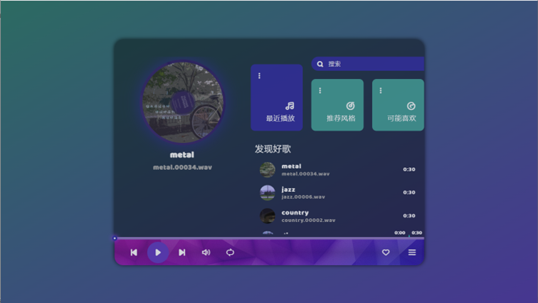

# Music Recommendation System

[中文说明](README.zh-CN.md)

A Django music-player application with an AlexNet-style PyTorch genre classifier and content-based top-five recommendations. This repository organizes a supplied 2022-era project archive; see [provenance](THIRD_PARTY.md) for the original material and acknowledgements.

## Implemented pipeline

Audio → mono / 22,050 Hz → crop or pad to five seconds → 128 MFCC coefficients (`log_mels=True`) → AlexNet-style CNN → ten genre scores → rank 20 randomly sampled candidates by the preferred genre's raw model score → return the top five tracks.

Genres: blues, classical, country, disco, hiphop, jazz, metal, pop, reggae, rock. Random playlists and random same-genre playlists are also implemented. Scores are logits, not calibrated probabilities. This archive contains no demonstrated collaborative filtering, lyric embeddings, Word2Vec or multimodal fusion implementation.



## Layout

- `recommend/`: Django application, templates and static player assets.
- `recommend/music/nn/`: network, audio dataset loader, inference and annotation CSV.
- `recommend.ipynb`: historical training notebook, with outputs removed and an obvious validation-batch bug corrected.
- `picture/`: historical architecture diagrams and screenshots.
- `README.original.md`: original supplied description and credits.
- `docs/CLEANUP.md`: archive review and reproduction limitations.

## Local setup

Use Python 3.10 in a dedicated virtual environment. The proposed package versions are a reproduction starting point, not a verified lockfile; this historical project is intended for local study.

```powershell
python -m venv .venv
.venv\Scripts\Activate.ps1
python -m pip install -r requirements.txt
```

Obtain GTZAN separately and place its genre directories under `recommend/music/static/GTZAN/genres_original/`. For example: `.../genres_original/blues/blues.00000.wav`. The bundled annotation CSV uses its original column order (filename in column 2, genre in the penultimate column, integer genre label last).

Place a trusted compatible state-dict checkpoint at `recommend/music/nn/best_model_okk.pth`, or set `MUSIC_MODEL_PATH` to its absolute path. Original local weights have been retained outside this repository. Never load untrusted pickle-based checkpoints. Model dimensions must match the 128-MFCC, five-second preprocessing and `net.py`.

```powershell
cd recommend
python manage.py migrate
python manage.py runserver
```

Open http://127.0.0.1:8000/project . The inference module loads audio metadata and the model at import, so Django commands require the data, dependencies and checkpoint first. Local development defaults to debug mode; production deployment requires separate review and configuration. Supported settings: `DJANGO_SECRET_KEY`, `DJANGO_DEBUG`, `DJANGO_ALLOWED_HOSTS`.

## Training and validation limits

The notebook retains historical experiments and requires adapting train/test paths, annotations, device settings and optional packages. A separate test-annotation file is referenced but absent from the supplied archive. Historical logs do not establish independently verified accuracy. This cleanup has not retrained the model or verified full audio inference.

## Credit

See [THIRD_PARTY.md](THIRD_PARTY.md) and [the original README](README.original.md). No new license is assigned to the original material.
